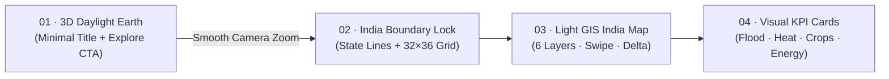

# VarshaTwin — UI/UX Design Specification (`design.md`)

> **Core Design Principles**
> 1. **Visual-First (No Walls of Words):** **80% Map & Visuals, 20% Numbers & Short Labels.** Maximum 2–3 words per label; maximum 1 short line per insight. Replace sentences with icons, badges, sparklines, and colorbars.
> 2. **Clean Daylight Theme:** High-contrast cartographic light theme (`#F8FAFC` canvas, `#FFFFFF` cards, `#E0F2FE` ocean basemap, `#0284C7` monsoon blue).
> 3. **Strict Grid Alignment:** Every panel, card, toolbar, and map edge locks to an **8px spatial grid** with fixed column widths and aligned horizontal datum lines.

---

## 1. Light Theme Color System

| Role | Token | Hex / Value | Usage |
| :--- | :--- | :--- | :--- |
| **App Canvas** | `--bg-canvas` | `#F8FAFC` | Outer page background (Cool Alabaster) |
| **Card / Panel** | `--bg-surface` | `#FFFFFF` | Sidebars, navbar, KPI cards |
| **Control Fill** | `--bg-muted` | `#F1F5F9` | Inputs, inactive tabs, slider tracks |
| **Floating Glass** | `--bg-glass` | `rgba(255, 255, 255, 0.88)` | Floating map HUD (`backdrop-filter: blur(12px)`) |
| **Map Ocean** | `--map-ocean` | `#E0F2FE` | Light bathymetry ocean background |
| **Map Land** | `--map-land` | `#FFFFFF` | India landmass base with `#94A3B8` state lines |
| **Border Hairline** | `--border` | `#E2E8F0` | `1px solid` aligned panel & card borders |
| **Text Primary** | `--text-main` | `#0F172A` | Numbers, headings, active labels |
| **Text Secondary** | `--text-muted` | `#475569` | Short 2-word labels, axis ticks |
| **Primary Accent** | `--accent` | `#0284C7` | Primary buttons, active tab, India boundary |
| **Success / Live** | `--success` | `#059669` | `Live` pill, `8/8 ✓` badge (fill `#ECFDF5`) |
| **Warning / Shock** | `--warning` | `#D97706` | Shock box border, heat alert (fill `#FFFBEB`) |
| **Danger / Surge** | `--danger` | `#E11D48` | Flood/cyclone alert badge (fill `#FFF1F2`) |

---

## 2. Typography & Text-Reduction Rules

| Element | Font | Size / Weight | Max Length Rule |
| :--- | :--- | :--- | :--- |
| **KPI Number** | `Inter` (`tabular-nums`) | `24px` · `700` | Number + unit only (e.g., `28.3 °C`, `272 mm`) |
| **Section Title** | `Inter` | `13px` · `600` | Max **2–3 words** (e.g., `Shock Studio`, `Impact KPIs`) |
| **Chip / Tab Label** | `Inter` | `12px` · `600` | Max **1–2 words** (e.g., `Rain`, `Temp`, `Wind`, `Swipe`) |
| **Card Sub-label** | `Inter` | `12px` · `500` | Delta badge only (e.g., `+14.8 mm/d vs Prime`) |
| **Coordinates** | `JetBrains Mono` | `11px` · `500` | Numbers only (`19.8°N, 85.8°E`) |

* **Banned on Main Screen:** Multi-sentence paragraphs, long technical explanations, repeated units, or raw variable codes (`t2m`, `tcwv`, `msl`) in primary labels (move details to hover tooltips).

---

## 3. Strict Alignment & Layout Grid (`1440 × 900`)

All views snap to a **3-column CSS Grid** with `16px` outer padding, `16px` column/row gaps, and `12px` border radius:

```text
+-----------------------------------------------------------------------------------+
| TOP BAR (56px) | [VT] VarshaTwin    [🌍 Globe]        [● Live] [184 ms] [8/8 ✓]   |
+----------------+-------------------------------------------------+----------------+
| LEFT RAIL      | CENTER MAP STAGE (Flex 1 · 816px)               | RIGHT RAIL     |
| (280px Fixed)  | +---------------------------------------------+ | (280px Fixed)  |
|                | | [Temp] [Rain*] [Wind] [Press] | [Split|Swipe]| |                |
| [1. Window   ] | +---------------------------------------------+ | +------------+ |
|  Monsoon Jun   | |                                             | | | 28.3 °C    | |
|                | |       ACCURATE GEOREFERENCED INDIA MAP      | | | +0.4°C  ▲  | |
| [2. Presets  ] | |         (Light GIS Base + State Lines)      | | +------------+ |
|  (•) Warm Bay  | |                                             | | | 3,528 cells| |
|  (•) Stall     | |             [Amber Shock Box]               | | | Heavy Rain | |
|  (•) Cyclone   | |                                             | | +------------+ |
|  (•) Zero Ctrl | |  [0 ────── 25 ────── 80+ mm/d]   [+][-][⟲]  | | | 995.7 hPa  | |
|                | +---------------------------------------------+ | | -3.8 hPa ▼ | |
| [3. Shock    ] | +---------------------------------------------+ | +------------+ |
|  N/S/E/W Box   | | [▶] D+1★ ── D+4★ ── D+8★ ── D+10 | Wavefront| | | HIGH SURGE | |
|  [+3.0°C ───●] | |     [Sparkline Curve: Near vs Outward]      | | | Odisha/AP  | |
|  [ Run Shock ] | +---------------------------------------------+ | +------------+ |
+----------------+-------------------------------------------------+----------------+
```

### Alignment Datum Rules
1. **Top Datum (`y = 72px`):** Top edge of Left Rail, Center Map Card, and Right Rail align on the exact same horizontal line.
2. **Bottom Datum (`y = 884px`):** Bottom edge of Left Rail, Bottom Timeline Bar, and Right Rail align on the exact same horizontal line.
3. **Uniform Card Grid:** Right Rail holds **4 equal-height KPI cards** (`12px` gap) + **1 compact Alert status card** — zero scrolling required at `1440 × 900` or `1920 × 1080`.
4. **Equal Input Columns:** Coordinates (`N`, `S`, `E`, `W`) use a `2 × 2` equal-width CSS Grid (`grid-template-columns: 1fr 1fr; gap: 8px`).

---

## 4. User Flow & Visual Architecture



### Screen 1: 3D Daylight Earth Intro
* **Background:** Soft atmospheric daylight gradient (`#E0F2FE` → `#F8FAFC`).
* **Centerpiece:** Realistic 3D rotating Earth with bright ocean blue, crisp continents, soft white clouds, and India highlighted in `#0284C7`.
* **Minimal Overlay (Left-Aligned):**
  * Logo + **1 Headline:** *"Understand Earth's Weather. Explore India's Future."*
  * **2 Buttons Only:** `Explore India →` (Primary Blue `#0284C7`) and `Skip` (Ghost).

### Screen 2: Georeferenced India Map Stage
* **True Cartography:** Accurate GeoJSON India country boundary & state boundaries (`Maharashtra`, `Odisha`, `Rajasthan`, `Tamil Nadu`, `Kerala`, `Gujarat`, `West Bengal`, `UP`, `J&K`) on a clean `#E0F2FE` ocean / `#FFFFFF` land basemap.
* **6 Layer Pills (1-Word Labels):** `Temp` · `Rain` · `E-Wind` · `N-Wind` · `Pressure` · `Moisture`.
* **3 Compare Pills:** `Split` · `Swipe` · `Delta Δ`.
* **Compact Hover Pill:** Floating white pill (`19.8°N, 85.8°E · Odisha · 42.6 mm/d (+14.8)`).

### Screen 3: Right Panel (Numbers + Icons Only)
* **4 Big Visual KPI Cards:** Each card contains only:
  1. Small icon + **2-word label** (`HEAVY RAIN`)
  2. Large **24px bold number** (`3,528 cells`)
  3. Colored **delta pill** (`+256 vs Prime` in green/amber/red)
* **1 Compact Trust Pill in Top Bar (`8/8 ✓`):** Clicking opens a clean popover checklist of the 8 physics checks so it never clutters the main screen.

---

## 5. Ready-to-Paste Light Theme Stitch Prompt (3 Core Screens)

Copy and paste this prompt directly into **Google Stitch**:

```text
Design a premium, production-grade scientific web application (Desktop 1440x900, LIGHT MODE) called "VarshaTwin — Climate Digital Twin of India", a neural weather forecasting and counterfactual monsoon simulation platform inspired by Apple Weather, Copernicus/ECMWF Light Climate Atlas, and Stripe/Linear precision interfaces.

VISUAL STYLE & PREMIUM LIGHT COLOR COMBINATION:
- Theme: Crisp Daylight Cartographic & Frosted Porcelain Light Theme.
  - App Canvas Background: Warm Porcelain Alabaster #F4F7FB
  - Card & Sidebar Surface: Pure Crisp White #FFFFFF with soft ambient elevation shadow (0 4px 20px rgba(15, 23, 42, 0.05))
  - Elevated Control / Input Fill: Soft Glacier Slate #EEF2F8
  - Frosted Glass HUD (over maps/globe): rgba(255, 255, 255, 0.86) with backdrop-filter blur(14px) and 1px border #E2E8F0
  - Hairline Borders & Grid Dividers: Crisp Slate #E2E8F0
  - GIS Map Base: Soft Azure Ocean Bathymetry #DBEAFE / #E0F2FE with Crisp Ivory India Landmass #FFFFFF, #94A3B8 state boundaries, and #1E293B coastline.
- Premium Accent Palette:
  - Primary Interactive Accent: Royal Monsoon Cobalt #0284C7 & Deep Cerulean #0369A1 (soft active tint #E0F2FE)
  - Secondary Atmospheric Accent: Indigo Teal #0D9488 (moisture & rainfall)
  - Verified / Live Status: Emerald Mint #059669 (pill background #ECFDF5, border #A7F3D0)
  - Thermal / Shock Bounding Box: Solar Amber #D97706 (pill background #FFFBEB, border #FDE68A)
  - Cyclone / Flood Surge Alert: Crimson Rose #E11D48 (pill background #FFF1F2, border #FECDD3)
- Typography & Minimal-Text Discipline:
  - Deep Ink Primary Text #0F172A, Secondary Label Slate #475569, Muted Axis/Unit Text #64748B.
  - Clean geometric sans-serif (Inter) for headings, large bold tabular numerals (24px) for KPI metrics, and monospace (JetBrains Mono) strictly for lat/lon coordinates and inference latency.
  - Visual-first layout (80% maps/globe/charts, 20% numbers & short 1–3 word labels). No long paragraphs or walls of words.
  - Strict 8px spatial grid alignment: top, bottom, and side edges of all columns and cards align along exact horizontal and vertical datum lines with 16px gaps and 12px–14px rounded corners.

GENERATE 3 CORE DESKTOP SCREENS (1440x900, LIGHT THEME):

SCREEN 1 — DAYLIGHT 3D EARTH INTRODUCTION (1440x900):
- Full-bleed daylight atmospheric viewport (#E8F1FA to #F4F7FB soft sky gradient) showcasing a photorealistic 3D rotating Earth globe with sapphire-blue oceans, crisp sunlit continents, soft white monsoon cloud swirls, and a subtle cerulean atmospheric halo.
- The Indian subcontinent (6.5°N–37.5°N, 65.5°E–100.5°E) is highlighted on the globe with a cobalt-blue (#0284C7) geospatial boundary and a floating white glass coordinate badge ("6.5°–37.5°N · 65.5°–100.5°E · 32×36 ERA5 Grid").
- Minimal floating white glass top bar: VarshaTwin logo, "Climate Digital Twin of India", emerald pill ("● LIVE · VarshaTwin-L3 · 184 ms"), and "Skip Intro →" button.
- Left floating frosted-porcelain hero card: Eyebrow pill "NEURAL ERA5 CLIMATE DIGITAL TWIN", bold dark-ink headline (#0F172A) "Understand Earth's Weather. Explore India's Future.", a 1-line subtitle, a primary cobalt-blue pill button "Explore India →" (#0284C7 with white text), and a secondary white button "Skip to Dashboard".
- Bottom aligned row of 3 compact white glass spec cards (icon + 3-word title + 1-line metric): (1) "3D Earth-to-India Zoom", (2) "Georeferenced 32×36 India Grid", (3) "8/8 Physics Verified Engine".

SCREEN 2 — MAIN GEOREFERENCED INDIA CLIMATE DASHBOARD (1440x900):
- Top Navigation Bar (56px, pure white #FFFFFF, 1px bottom border #E2E8F0): VarshaTwin logo + title, "🌍 3D Globe" button on left; emerald status pill ("● LIVE · 127.0.0.1:8000"), Model chip ("VarshaTwin-L3 · 184.2 ms"), emerald badge ("8/8 Physics ✓"), and Settings icon on right.
- Strictly Aligned 3-Column Workspace (16px outer padding, 16px column gaps):
  1. Left Control Sidebar (280px fixed, white card #FFFFFF):
     - Weather Window dropdown ("Monsoon Onset · Mid-June · DOY 166").
     - 4 compact Scenario Preset chips with colored dots: "Warm Bay (+3.0°C)" [Active, #E0F2FE fill, #0284C7 border], "Monsoon Stall (-40% Wind)", "Zero Shock Control (0.0σ)", "Bay Cyclone (-900 Pa)".
     - Shock Studio: Clean 2×2 coordinate grid (8.0°N, 20.0°N, 82.0°E, 94.0°E), Variable select ("Temperature"), "+3.00 K" slider, primary cobalt button "Run Simulation" (#0284C7), and 2 equal-width secondary buttons ("Monte Carlo", "Verify Null").
  2. Center Main Stage (816px, top and bottom edges aligned with sidebars):
     - Top floating white toolbar: 6 short layer pills ("Temp" | "Rain" [Active #0284C7] | "E-Wind" | "N-Wind" | "Pressure" | "Moisture") on left; Compare toggle ("Split" | "Swipe" | "Delta Δ") on right.
     - Large Interactive Georeferenced India Map Card (Light GIS Cartography): Accurate geographical India country boundary and state boundaries (Maharashtra, Odisha, Rajasthan, Tamil Nadu, West Bengal, Kerala, Gujarat, UP, J&K) with crisp dark-slate state labels on an ivory landmass (#FFFFFF) and soft azure ocean (#DBEAFE), smooth teal-cobalt monsoon rainfall heatmap contours, dark-slate wind vector arrows, a solar-amber shock box over the Bay of Bengal (8°–20°N, 82°–94°E) with a dashed cobalt 3-cell locality ring, top-right white zoom/reset/3D buttons, bottom-left colorbar legend (0 to 80+ mm/day), and a compact white glass hover pill over Odisha ("19.8°N, 85.8°E · Odisha · 42.6 mm/d · +14.8").
     - Bottom Timeline & Wavefront Bar (120px, white card #FFFFFF): Play/Pause button + Day 1 to Day 10 step pills (D+1★, D+4★, D+8★ highlighted in cobalt blue) on left; clean dual-line Causal Wavefront sparkline chart (Amber Near-Shock vs Cobalt Outward Ripple) + Cell Inspector pill on right.
  3. Right Analytics Rail (280px fixed, 5 equal-aligned white KPI cards stacked with 12px gaps):
     - Card 1: "AVG TEMPERATURE" · "28.3 °C (301.4 K)" · "+0.42 K vs Baseline"
     - Card 2: "HEAVY RAINFALL" · "3,528 cell-days" · "+256 (>10 mm/d)"
     - Card 3: "SEA-LEVEL PRESSURE" · "995.7 hPa" · "-3.8 hPa Bay Core"
     - Card 4: "COLUMN MOISTURE" · "54.8 kg/m²" · "+13.2% Vapour Flux"
     - Card 5: "FLOOD & SURGE RISK" · "HIGH SURGE" (Crimson Rose #E11D48 badge) · "Odisha & AP Coast · σ ±1.85 mm/d"

SCREEN 3 — MULTIVERSE COMPARISON & IMPACT INTELLIGENCE STUDIO (1440x900, LIGHT THEME):
- Top half (3 Equal-Width Aligned White Map Cards, 16px gap):
  (A) "Baseline Climate (Timeline Prime)" — Georeferenced light-GIS India map under normal Bay of Bengal conditions ("Mean: 14.2 mm/d"),
  (B) "Branched Multiverse (+3.0°C Bay) · Swipe Compare" — Georeferenced India map with a vertical cobalt swipe divider handle splitting Baseline (left) vs +3°C Alternate (right) across India's state boundaries ("Mean: 17.8 mm/d"),
  (C) "Counterfactual Difference Map (Δ)" — Georeferenced India map with diverging cobalt-blue to coral-red anomaly contours and wind shift vectors ("Peak Δ: +18.4 mm/d").
- Bottom half: Clean 5-Card "Impact Intelligence" grid (equal height, aligned columns, minimal text — 1 badge + 1 big metric + 1 short line per card) explicitly tagged with either a cobalt badge "VALIDATED MODEL OUTPUT" or an amber badge "DERIVED ESTIMATE":
  1. Flood & Surge Risk: "+24% Basin Runoff" · "995.7 hPa · Mahanadi & Godavari Coast" [DERIVED ESTIMATE]
  2. Heatwave Stress: "412 cell-days" · "Wet-Bulb Proxy ≥ 38°C · Indo-Gangetic Belt" [DERIVED ESTIMATE]
  3. Agriculture & Crops: "+7.8% Land Rain" · "153.5 mm 10-Day Mean · Coastal Drainage Alert" [VALIDATED OUTPUT]
  4. Heavy-Rain Footprint: "3,528 cell-days" · "tp > 10 mm/day · 84% Monte Carlo Probability" [VALIDATED OUTPUT]
  5. Renewable Energy Grid: "+18% Wind · -14% Solar" · "+610 MW Cooling Demand Surge" [DERIVED ESTIMATE]
```
